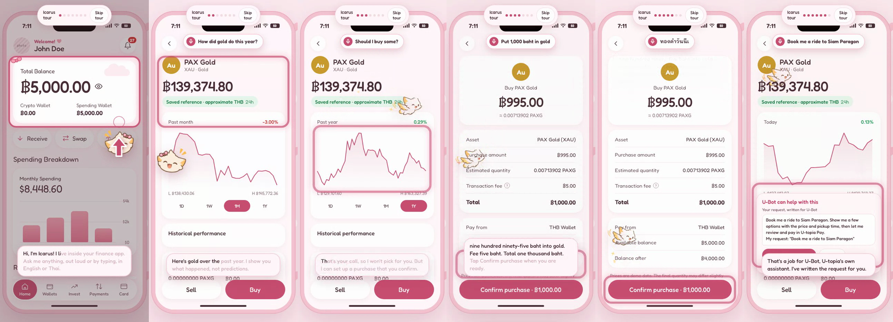

# Icarus

**Icarus: fly without falling.** A guide that lives inside a finance app. It explains the screens in plain words, moves through the app for you, and never buys without your tap. By voice or text, in English or Thai.

> Robinhood built an AI for Robinhood. Icarus is the AI for every other finance app. It walks new users through the app in their own words, and tells the business where they got stuck.

Built for U-Hackathon 2026 (FLOW Summit, Bangkok, 15 to 16 Oct 2026), AI track. Icarus plugs into any finance app; U-topia is the first partner. (Planning notes from the hackathon are in [`docs/team-notes/`](docs/team-notes/).)

**Live demo: no public URL yet.** No deployment has been verified, so none is linked here. Run it locally (see [Showcase](#showcase-run-everything-with-one-command)); the app opens with a one-minute tour by the mascot, so turn your sound on. Hosting config exists but is untested on a real host: a [`Dockerfile`](Dockerfile) and [`render.yaml`](render.yaml) for Render, and a Vercel guide in [`docs/hosting-vercel.md`](docs/hosting-vercel.md).



[Watch the tour (57 s video)](docs/media/icarus-tour.mp4) · [as a GIF](docs/media/icarus-tour.gif). Recorded from the running app; the video has no sound, the captions are what the mascot says.

## Try it in two minutes

1. **Watch the tour**, or tap **Tour** in the corner any time. The mascot shows everything below on the real screens.
2. Open Icarus (the mascot button) and say or type **"Put 1,000 baht in gold."** Icarus fills in the buy screen, reads back the amount, fee and total, and stops at Confirm. You tap.
3. **"How did bitcoin do this year?"** A chart, with numbers from market data.
4. **"Should I buy bitcoin?"** Icarus won't pick for you. It offers facts instead.
5. **"ดูราคาทองคำ"** It speaks Thai too.
6. **"Book me a ride to Siam Paragon."** Not a finance task: Icarus writes the request for U-Bot, U-topia's own assistant, and opens it.
7. **The race:** in the side panel, buy 1,000 baht of gold by tapping through the app, then again by voice. A stopwatch times both.
8. **The business view:** the dashboard shows what users asked and where they got stuck.

**What is real when the backend is connected:** market prices (Binance, Frankfurter for baht; the app shows when they were last updated, and marks them delayed once they are more than two minutes old), ElevenLabs voice (Scribe v2 Realtime listening, Flash v2.5 and v4 Turbo speaking), the AI answers, and the U-Bot link. **What is demo:** the account (every visitor gets their own 5,000 baht), the fee rule (0.25%, at least 5 baht), and the purchases: no real money moves.

## How it works


Code does the work, the AI finds the words. The backend works out what the user wants and gets the numbers first (prepared fact sheets, refreshed with every price), so plain requests never wait for an AI: 8 everyday questions went from 42 s to 3 s in total (measured 16 Oct 2026). New questions get one short AI call, and a backup model answers if the first is slow; if the same opening question is asked again on the same screen within 5 minutes, and the facts it would quote have not changed, the saved answer comes back instantly. Only a first question is saved this way. Answers that use a person's own account or history are kept per account and are never shared. New questions are logged, so the most-asked ones become prepared answers. A 100-question battery (`backend/scripts/battery100.py`) checks the answers and the house rules. Everyday conversation too: 124 turns of small talk, feelings and off-topic questions in English and Thai (`backend/scripts/battery_chat.py`), 88 answered in under a second and none over 5.3 s ([qa/battery/chat.md](qa/battery/chat.md), 16 Oct 2026). Drawn in [`docs/architecture.html`](docs/architecture.html).

## The problem

When people open a finance app, the screens, charts and terms are hard to get into. That friction makes platforms lose users before they do anything.

- 68% of consumers have abandoned a financial services application mid-onboarding (Signicat, 2022).
- Fintech activation rates sit at about 5% (Agile Growth Labs 2025 benchmark).
- 76% of fintech users who convert do so within the first 7 days (Mixpanel 2025).

The first week decides everything, and most users quit before they understand the app.

## What the user gets

1. **Ask about anything on screen.** "What does this red number mean?" Icarus answers with the user's own account data.
2. **Show me.** Icarus highlights the next button or field on the real screen.
3. **Say it instead of tapping through it.** "Put 1,000 baht in gold." Icarus turns a multi-step trade screen into one sentence and a preview card with one confirm button.
4. **Voice or text**, English or Thai.
5. **A companion, not a teacher.** Icarus remembers where the user is in their journey (signed up, deposited, first purchase) and helps with the next step.

Plus: portfolio facts, fact-based comparisons, what-if math, goal math and plain-words risk.

## What the business gets

Businesses pay. Users never do. They get more users reaching a first deposit, fewer "what does this mean?" support tickets, and a **friction map**: a dashboard of what users ask and where they get stuck. Every question is a bug report.

## Hard rules

These apply to every line of code in this repo.

1. **No personal investment advice.** Icarus explains, compares on facts, calculates and alerts. It never tells a user to buy or sell a specific asset.
2. **Confirm before every action.** Icarus prepares. The user confirms. It shows exactly what will happen: asset, amount, fees, final total.
3. **Numbers come from data, never from the LLM.** Every price, balance and percentage comes from a tool call.
4. **Voice is never login or approval.** Voice cloning makes voice unsafe for authentication. Confirmation is a tap.
5. **Be honest about the demo.** Say what is live, what is mocked and what is simulated.
6. **Event rules.** Humans only on the team, and everyone can explain their own code.

Style for anything we write: plain English, short sentences, no em dashes. Icarus talks the same way: short, calm, no jargon.

## Who builds what

| Part | Owner | Where |
|---|---|---|
| Data pipeline, user journey, the assistant (the "brain") | Luka and First | [`backend/`](backend/) |
| **Voice in and out, and how Icarus talks (this repo's `voice/`)** | KP | [`voice/`](voice/) |
| App mockup, frontend, friction dashboard | Oasis | [`frontend/`](frontend/) (the prototype, running and paired with voice) |

The parts connect through one reply format. The assistant returns `text`, `speak`, `ui_actions` and `sources`. Voice input becomes text for the same assistant, and the assistant's `text` goes to text-to-speech when `speak` is true. One pipeline for voice and text, so they behave the same.

## The demo (about 3 minutes)

A volunteer who has never used a crypto app is asked to buy 1,000 baht of gold, once with the normal screens and once with Icarus, with a stopwatch on screen. Then they tap the chart and ask what it means, by voice. Last, the friction dashboard shows what people asked and where they got stuck.

## Showcase: run everything with one command

```bash
./demo.sh
```

It builds the app, starts the voice server and the backend, checks the backend's `/health`, and opens **http://localhost:8787/app/?backend=http://localhost:8001**. It runs the backend's legacy engine on purpose (the real-model path). Needs `voice/.env` with the ElevenLabs key (see `voice/.env.example`).

- **With a model** (Ollama with the `icarus` model, or `backend/.env` with `LLM_PROVIDER=groq` and `GROQ_API_KEY`): the real brain answers everything.
- **Without one:** the backend runs its stand-in brain (simple rules, no AI). Buys, charts and how-to steps, and the common questions it has prepared answers for (prices, fees, "what is bitcoin?", "should I buy?"), still come from the backend with market prices. Anything else fails on purpose and the app falls back as below.
- **If the backend cannot answer** (down, no model, slow): a plain screen move may use the prototype's scripted answer, labelled "Scripted demo answer". Anything else gets an honest reply: "Sorry, I can't answer that one right now," with three things that still work. Icarus does not invent an answer. See [`qa/failure-drills.md`](qa/failure-drills.md).
- `./demo.sh --app-only` runs the prototype's scripted answers only, with no backend.
- **Windows:** `scripts/run-demo.ps1` starts the voice server and the backend's model engine. By default all of it is offline: the model's offline preview (not a live model), saved prices instead of live ones, and fake voice (tones). `-Gateway` uses the live model gateway and `-RealVoice` real speech (needs `voice/.env`). Build the frontend first.
- **Any platform, no key and no backend:** `cd voice && npm run dev:fake`, then open http://localhost:8787/app/.
- A buy ("Put 1,000 baht in gold") fills in the app's own buy screen and stops on Review purchase. Icarus reads back the numbers on that screen, and the volunteer taps Confirm purchase (the stopwatch stops there).
- Voice needs a microphone the browser may use: open the app in Chrome or Brave and allow the mic.

## How the parts connect

[`INTEGRATION.md`](INTEGRATION.md): the whole chain (microphone, app, U-Bot router, backend, speech), how to run all three parts together, what was checked end to end, and what the team still has to agree.

## Business plan

[`docs/business-plan.md`](docs/business-plan.md): what Icarus costs to run per partner (team, model, voice, servers), how many machines, the price at a 20% margin, whether it pays for itself for U-topia, and the tiers we recommend. Every number comes from [`docs/cost_model.py`](docs/cost_model.py). [`docs/pricing-calculator.html`](docs/pricing-calculator.html) is the same model with sliders (open it in a browser).

## Voice

The voice pipeline is in [`voice/`](voice/). It has its own README with setup, the module the frontend drops in, and what is mocked. Start here:

```bash
cd frontend && npm install && npm run build   # the app (Oasis's prototype)
cd ../voice && npm install
npm run dev:fake     # works with no API key. Open http://localhost:8787/app/
```

## Model prototype (Luka and First)

The standalone model and data-processing prototype is in [`model/`](model/). It includes English/Thai retrieval, deterministic financial tools, explicit user-context intake, versioned app-data adapters, and exploratory risk baselines. It has no trade-execution endpoint.

Start with [`model/START_HERE.md`](model/START_HERE.md). The app/backend data contract is in [`model/INTEGRATION.md`](model/INTEGRATION.md). Guidance rules and translations remain drafts for team review before enabling them in the shared app.

```powershell
python -m unittest discover -s model/tests -v
python model/assistant.py --interactive --lang en --session demo
```

Private `model/.env`, local conversations, generated reports, and downloaded/generated market data are ignored. Copy only the public `.env.example` template when setting up another machine.
